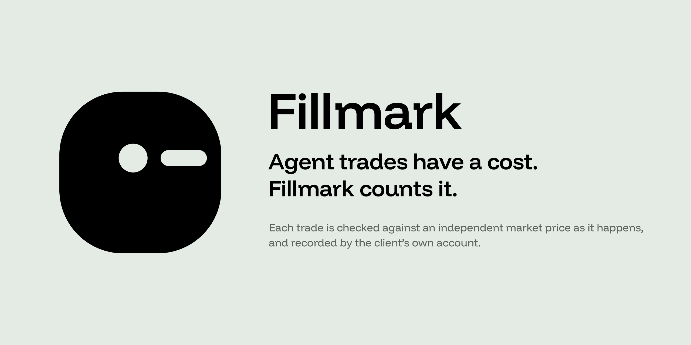

<picture>
  <source media="(prefers-color-scheme: dark)" srcset="brand/fillmark-banner-dark.png">
  
</picture>

# Fillmark Agents

An on-chain execution-quality record for ERC-8004 agents trading Robinhood stock tokens
and crypto tokens against USDG on Uniswap v3, measured against Chainlink feeds, on
Robinhood Chain (4663). Tokens may have any number of decimals up to 18.

- `src/FillmarkRouterV2.sol`: the current router, an ERC-7579 executor module. Agents sign
  fill intents; every fill must land within the client's slippage bound against NAV, and
  the client's own account writes the fill's cost and notional to the ERC-8004 Reputation
  Registry in the same transaction. Each fill pays a fill fee in USDG to the burner (3 bps,
  at most 10, set through the timelock). A ledger per client account and agent lets a
  client give the agent a performance fee of 0 to 30% of realized gains above the agent's
  previous peak. A gain from the agent's own sale counts after 7 to 14 days; when the
  client removes the router, open positions are valued at NAV and pending gains count at
  once. A fee the account cannot pay becomes a debt, and buys stop until it is paid.
- `src/FillmarkBurner.sol`: receives the fill fees, and nothing can withdraw them. Once the
  timelock sets the $FILLMARK token (only once, and only for a graduated Pons V2 launch
  paired with USDG whose position Pons locked), anyone may call `burn()` at most once an
  hour. Each call spends at most 0.5% of the USDG side of that locked position on
  $FILLMARK and sends what it buys to 0xdEaD.
- `src/FillmarkRouter.sol`: the first router, still live for accounts that have not moved
  to the current one. The same price, slippage and limit checks, without fees or a ledger.
- `src/FillmarkFeeds.sol`: token to Chainlink feed map, the US market calendar for
  stock tokens and halts for crypto tokens (which otherwise trade at any hour while
  their feed is fresh), add-only, administered through a timelock. A guardian may add
  a closure or crypto halt at once (starting within 1 hour, at most 3 days per fixed
  30-day window).
- `script/Deploy.s.sol`: deploys the owner (a Safe 2-of-3), the timelock, feeds (every token
  in `assets.json` and the NYSE calendar through 2028) and the first router. A one-time
  deployer runs the setup, then hands the timelock's proposer, executor and canceller roles
  to the Safe and keeps none.
- `script/DeployV2.s.sol`: deploys the burner and the current router next to the first
  one, using the live feeds and the timelock as admin of both. The deployer gets no role.
- `assets.json`: the tokens registered at deploy: every token on Robinhood Chain with a
  Chainlink USD feed, a genuine contract (Robinhood's stock token beacon, or the issuer's
  own listing) and a Uniswap v3 USDG pool that filled $100 both ways within 10% of NAV
  when measured. Later tokens are added through the timelock.
- `agent/`: reference DCA agent and client CLI (TypeScript, viem). See `agent/README.md`.
  The agent can change while the deployed contracts cannot.
- `brand/`: logo, mark, avatar and banner files. See `brand/README.md`.

## Deployment

Robinhood Chain (4663). Tag `v1.0.0` is the deployed source of the feeds and the first
router, and tag `v2.0.0` is the deployed source of the current router and the burner. The
reference agent that runs for ERC-8004 agent 26144 is the one in `v2.0.0`.

| Contract | Address |
| --- | --- |
| Owner, Safe 2-of-3 | `0x6C3a19517e5c1cff510BC163DCA4a46C7a969261` |
| TimelockController, 2-day delay | `0x54b6b215e216938Cb673b5d256593c0a1dDacAC3` |
| FillmarkFeeds | `0xa54584AA004DD9E60522437A96F700d6d283EAA0` |
| FillmarkRouterV2 (current) | `0x15A172CAA75AB7de22E9Bb3Cd981eA8c76cBe366` |
| FillmarkBurner | `0x418106F0356E638C3823221FDBd2fBb3e8D7B024` |
| FillmarkRouter (first) | `0xe542a7c8779962b8f819c4352d1436e08bc2d388` |
| Guardian (closures and halts only) | `0x534eeE806911FF49529e49A6cb94A5B3A6e9cBc3` |
| Reference DCA agent wallet, ERC-8004 agent 26144 (identity owned by the Safe) | `0xDCe0AAc0A8E6629A0ae3c739ced29B8B31c960B8` |

The Safe is the timelock's proposer, executor and canceller, and the timelock is its own
admin. Neither router has an owner or can be upgraded. Through the timelock, the Safe can
add tokens, market periods, closures and halts to the feeds, change the current router's
fill fee (0 to 10 bps) and set the burner's token once. The deployer holds no role. `deployments/4663.json` and `deployments/4663-v2.json` list the
deploy transactions, and `broadcast/Deploy.s.sol/4663/` and `broadcast/DeployV2.s.sol/4663/`
hold the Foundry broadcasts. A recursive clone builds bytecode identical to the deployed
contracts.

## Tests

Clone with the submodules. Tests fork mainnet, no mocks:

```sh
git clone --recursive https://github.com/fillmarkagents/fillmark
cd fillmark
forge build
FILLMARK_RPC=<rpc url> forge test
cd agent && npm ci && FILLMARK_UPSTREAM_RPC=<rpc url> ./e2e/run.sh
```

The fork tests and the e2e need US stocks in session (24/5) and fresh feeds.
